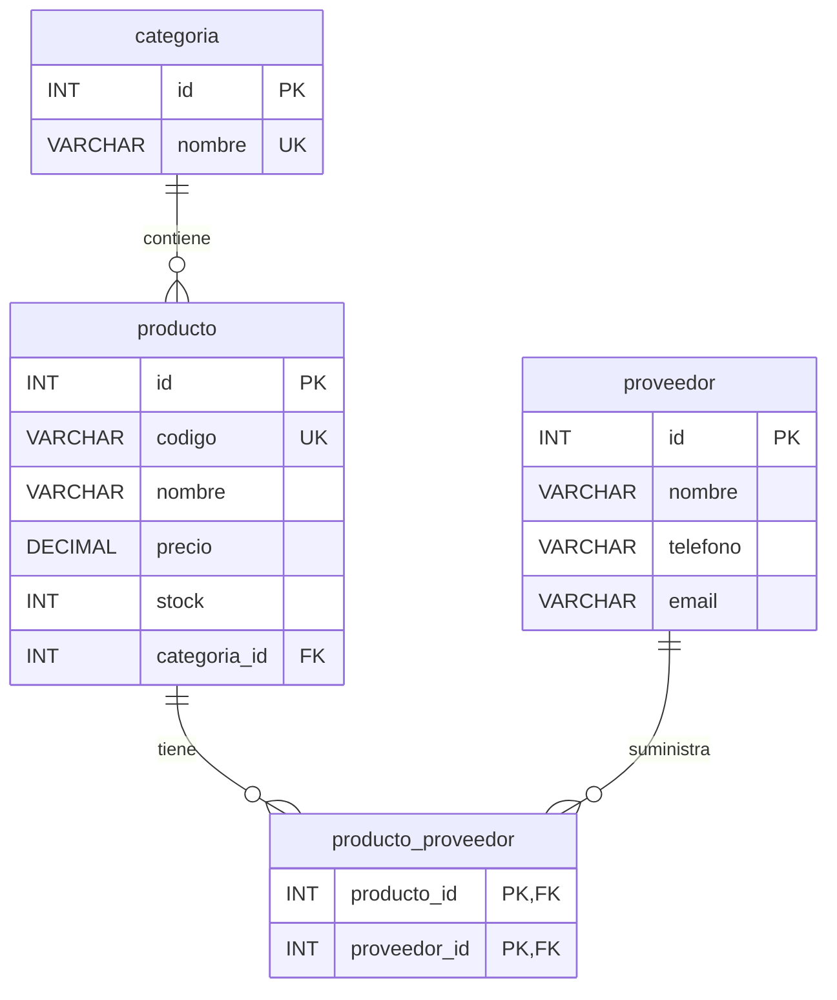
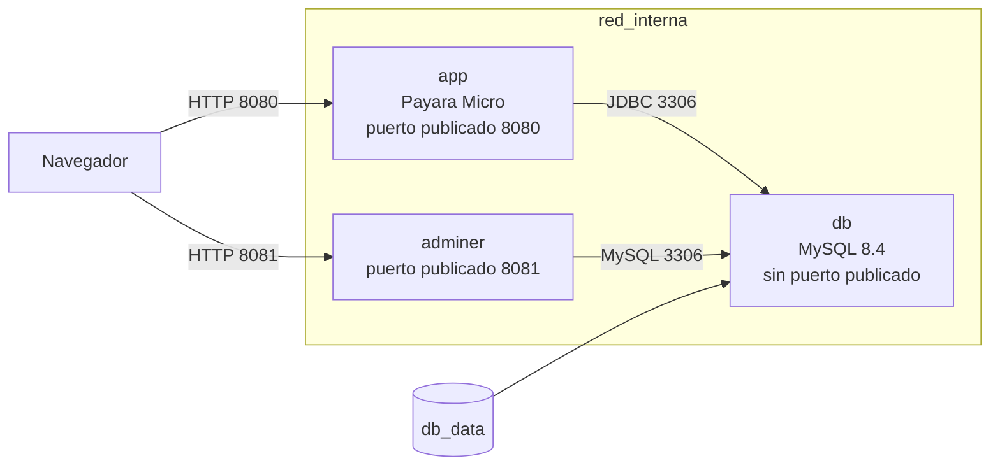

# Inventario de tienda

Dmitry Randos Efimov. 2º DAM, módulo de Acceso a datos.

## Descripción

Aplicación web para administrar productos, categorías y proveedores, y relacionar proveedores con productos. La interfaz
está hecha con HTML, CSS y JavaScript sin librerías externas. La API usa JAX-RS de Jakarta EE 11, y guarda los datos en
MySQL.

Tecnologías principales: Java 21, Maven, Payara Micro, MySQL 8.4, MySQL Connector/J, JUnit 5, Mockito y H2 para los
tests.

## Modelo de datos



## Contenedores



## Arquitectura por capas

Las clases Java están en `com.tienda.inventario` y se organizan en estos paquetes:

- `api`: recursos REST, configuración de JAX-RS y conversión de errores HTTP.
- `servicio`: validaciones y operaciones de negocio.
- `dao`: acceso a la base de datos mediante JDBC.
- `modelo`: entidades del dominio.
- `dto`: objetos intercambiados con la API.
- `excepcion`: excepciones de validación, ausencia de datos, conflictos y acceso a datos.

La interfaz está en `src/main/webapp`: `index.html`, `css/estilos.css` y los módulos JavaScript de `js/`.

## Puesta en marcha

Se necesita Docker con Docker Compose.

1. Clona el repositorio y entra en su directorio. Sustituye el marcador por la URL del repositorio:

   ```sh
   git clone <URL_DEL_REPOSITORIO>
   cd inventario-tienda
   ```

2. Crea el archivo local de configuración:

   ```sh
   cp .env.example .env
   ```

3. Si hace falta, edita `.env`. Sus variables son:
    - `DB_ROOT_PASSWORD`: contraseña del usuario administrador `root` de MySQL.
    - `DB_NAME`: nombre de la base de datos.
    - `DB_USER`: usuario de MySQL que usa la aplicación.
    - `DB_PASSWORD`: contraseña de ese usuario.

4. Construye y arranca los servicios:

   ```sh
   docker compose up --build -d
   ```

Docker Compose usa `db/init.sql` para inicializar una base de datos nueva con datos de prueba.

La aplicación tarda unos 30 segundos en estar disponible después de arrancar los contenedores.

## Puertos y credenciales de prueba

Los valores de `.env.example` son:

| Variable           | Valor                   |
|--------------------|-------------------------|
| `DB_ROOT_PASSWORD` | `example_root_password` |
| `DB_NAME`          | `inventario`            |
| `DB_USER`          | `inventario_user`       |
| `DB_PASSWORD`      | `example_db_password`   |

- Aplicación: [http://localhost:8080](http://localhost:8080).
- Adminer: [http://localhost:8081](http://localhost:8081). Selecciona `MySQL` como sistema, usa `db` como servidor,
  `inventario_user` como usuario, `example_db_password` como contraseña e `inventario` como base de datos.
- MySQL no publica ningún puerto en el equipo; la aplicación y Adminer acceden a MySQL por la red interna de Docker.

## Uso de la interfaz

La página inicial muestra la sección Productos. Usa la navegación superior para cambiar entre Productos, Categorías y
Proveedores.

- En Productos, completa el formulario con código, nombre, precio, stock y categoría para crear un producto. Usa Editar
  para cargar un producto en el formulario y Borrar para eliminarlo tras confirmar. El botón Proveedores permite marcar
  o desmarcar proveedores y guardar la selección.
- En Categorías y Proveedores, usa los formularios para crear o editar registros y los botones de la tabla para editar o
  borrar. El borrado pide confirmación.
- Los mensajes de carga, éxito y error aparecen sobre la sección. Las nuevas categorías y las categorías borradas
  actualizan el desplegable del formulario de productos.

## API

La API devuelve JSON y sus rutas comienzan por `/api`. Los errores se devuelven como `{"error":"mensaje"}`. El mapeo
general usa `400` para validaciones, `404` para elementos inexistentes, `409` para conflictos y `500` para otros
errores.

| Método   | Ruta                              | Respuesta correcta |
|----------|-----------------------------------|--------------------|
| `GET`    | `/api/estado`                     | `200`              |
| `GET`    | `/api/productos`                  | `200`              |
| `GET`    | `/api/productos/{id}`             | `200`              |
| `POST`   | `/api/productos`                  | `201`              |
| `PUT`    | `/api/productos/{id}`             | `200`              |
| `DELETE` | `/api/productos/{id}`             | `204`              |
| `GET`    | `/api/productos/{id}/proveedores` | `200`              |
| `PUT`    | `/api/productos/{id}/proveedores` | `204`              |
| `GET`    | `/api/categorias`                 | `200`              |
| `GET`    | `/api/categorias/{id}`            | `200`              |
| `POST`   | `/api/categorias`                 | `201`              |
| `PUT`    | `/api/categorias/{id}`            | `200`              |
| `DELETE` | `/api/categorias/{id}`            | `204`              |
| `GET`    | `/api/proveedores`                | `200`              |
| `GET`    | `/api/proveedores/{id}`           | `200`              |
| `POST`   | `/api/proveedores`                | `201`              |
| `PUT`    | `/api/proveedores/{id}`           | `200`              |
| `DELETE` | `/api/proveedores/{id}`           | `204`              |

Las operaciones que reciben datos usan JSON. En particular, `PUT /api/productos/{id}/proveedores` recibe una lista JSON
de identificadores de proveedor.

## Tests

Ejecuta los tests con Java 21 y Maven:

```sh
mvn test
```

Los tests de servicios usan Mockito para comprobar creación, consulta, validaciones y casos de identificadores
inexistentes. Los tests de DAO ejecutan operaciones CRUD y comprueban restricciones como códigos o nombres repetidos,
categorías con productos y relaciones producto-proveedor. Usan H2 en memoria en modo MySQL y cargan
`src/test/resources/esquema-test.sql` antes de cada test.

## Persistencia

Los datos de MySQL se guardan en el volumen con nombre `db_data`. `docker compose down` elimina los contenedores, pero
conserva ese volumen. `docker compose down -v` también elimina el volumen y borra los datos persistidos.

## Decisiones técnicas

- La conexión entre la aplicación y MySQL tiene el cifrado SSL desactivado. Ambos servicios se comunican por la red
  interna de Docker.
- Los tests de DAO usan H2 en memoria, en modo compatible con MySQL; no necesitan una instancia MySQL para ejecutarse.

## Uso de IA

El proyecto se ha desarrollado con el agente Junie. Los prompts, las decisiones y las correcciones están
en [AI_WORKFLOW.md](AI_WORKFLOW.md).